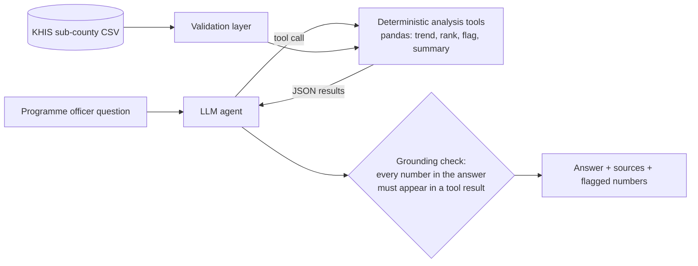

# Kenya Malaria Insights

**LLM-assisted, verifiable analysis of sub-county malaria indicators for county and national malaria programme decision-makers.**

County malaria teams in Kenya hold rich routine data (KHIS/DHIS2), but turning spreadsheets into timely, trustworthy answers — *Where is test positivity rising? Which sub-counties should we prioritise for net distribution?* — takes analyst time that is often not available. This prototype lets programme staff ask questions in plain language and get short answers and one-page briefs, **without the language model ever inventing a number**.

> Status: working prototype (v0.1, October 2026). Built by Bulinda Major Vincent (Kisii University) as part of an EMOD-based malaria modelling programme for the Lake Victoria endemic zone, Western Kenya.

---

## What it does

| Command | What you get | Needs an API key? |
|---|---|---|
| `validate` | Data-quality report: missing values, out-of-range rates, duplicate rows | No |
| `rank` | Sub-counties ranked by any indicator, for any year or county | No |
| `brief` | One-page Markdown brief with a figures table, trend chart and plain-language interpretation | No (optional `--llm` narrative) |
| `ask` | Natural-language Q&A, e.g. *"Which sub-counties in Kisumu had rising test positivity?"* | Yes |

## How it works



1. **Validation first.** The CSV is checked and problems are reported; missing values are never filled in.
2. **Tools do the maths.** The LLM (Claude, via the Anthropic Messages API) can only call five analysis functions (`list_units`, `subcounty_trend`, `rank_subcounties`, `flag_rising`, `county_summary`). It never computes statistics itself.
3. **Grounding check.** Every number in the model's final answer is compared with the tool outputs. Any figure that does not appear in a tool result is flagged as **"CHECK: unverified"** for human review.
4. **Traceability.** Each answer lists the exact tool calls (with arguments) used to produce it.

## Quick start

```bash
git clone https://github.com/<your-username>/kenya-malaria-insights.git
cd kenya-malaria-insights
pip install -e ".[charts]"

# Put your KHIS export in data/ (see data/README.md for the columns)
malaria-insights validate data/my_khis_export.csv
malaria-insights rank data/my_khis_export.csv test_positivity --county Kisumu --top 5
malaria-insights brief data/my_khis_export.csv "Nyando" --out reports/

# Natural-language questions (requires an Anthropic API key)
export ANTHROPIC_API_KEY=...
malaria-insights ask data/my_khis_export.csv "Where did confirmed cases per 1,000 rise most between 2022/23 and 2024/25?"
```

Run the tests (standard library only, no API key needed):

```bash
python -m unittest discover -s tests -v
```

The tests use a small **synthetic** fixture (`tests/fixture_synthetic.csv`, fictional counties "Alpha" and "Beta") and a scripted fake model, including a test that confirms a hallucinated figure is caught by the grounding check.

## Responsible AI

Designed around the EDSAFE AI Alliance **SAFE** principles (Safety, Accountability, Fairness, Efficacy):

- **Safety and privacy:** inputs are aggregate sub-county indicators, so no personal or patient-level data is processed. Real data files are git-ignored by default.
- **Accountability:** every answer shows its sources (tool calls), and generated briefs carry a note that programme staff must review them before use.
- **Fairness:** answers report data gaps (missing years, incomplete reporting) rather than hiding them, because low reporting completeness often affects the hardest-to-reach sub-counties first.
- **Efficacy:** numerical grounding checks and unit tests guard against the main failure mode of LLMs in analytics, which is confident but invented figures.

## Limitations and next steps

- Routine data quality (reporting completeness, testing rates) limits interpretation; the next version will ingest completeness indicators alongside cases.
- Planned: link sub-county priorities to EMOD intervention scenarios (dual-active-ingredient ITNs, focal IRS) so that "where" questions connect to "what works" modelling results.
- Planned: Kiswahili answers, and DHIS2 API ingestion instead of CSV export.

## Project structure

```
src/malaria_insights/
  data.py      # loading, column aliases, validation report
  analysis.py  # deterministic tools (trend, rank, flag rising, summary)
  llm.py       # tool-use agent, Anthropic API client (stdlib only), grounding check
  brief.py     # one-page sub-county brief + chart
  cli.py       # command-line interface
tests/         # unit tests with synthetic fixture and fake model
data/          # your data goes here (git-ignored)
```

## License

MIT © 2026 Bulinda Major Vincent
